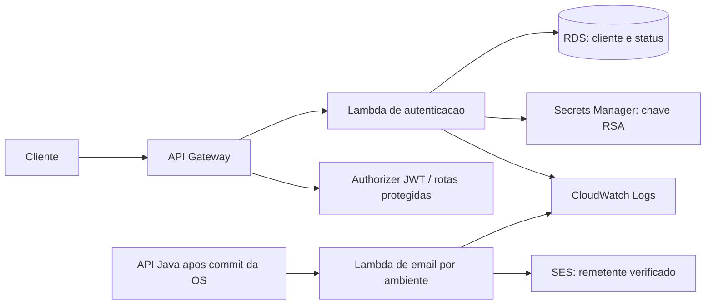

# fiap-lambda

Funções serverless de autenticação por CPF/e-mail e notificações de ordens de serviço. O cliente ativo recebe JWT RS256; o envio de e-mail usa uma Lambda por ambiente e Amazon SES.

📚 **[Documentação principal — fiap-docs](https://github.com/FIAP-GRUPO05/fiap-docs)**

## Tecnologias e requisitos

Python 3.12, boto3, PyJWT, PostgreSQL, AWS Lambda, API Gateway, SES e Terraform 1.13+. Docker com Compose v2 permite testar o runtime local. AWS CLI autenticado é necessário somente para o bootstrap administrativo; o CI usa OIDC.

## Arquitetura deste componente



## Testar localmente

Na raiz deste repositório, em PowerShell:

```powershell
python -m venv .venv
./.venv/Scripts/python.exe -m pip install -r requirements-dev.txt
./.venv/Scripts/python.exe -m coverage run --source=codetoken,codeemail -m unittest discover -s tests -v
./.venv/Scripts/python.exe -m coverage report --fail-under=90
docker compose -p fiap-notifications-local -f compose.notifications.yaml up --build -d
python .github/scripts/local_notification_smoke.py
```

O teste Docker chama o runtime Lambda em `http://127.0.0.1:19000` e confirma HTML, texto e correlação no [MailHog local](http://127.0.0.1:18025). Nenhum e-mail sai para a internet. Para encerrar: `docker compose -p fiap-notifications-local -f compose.notifications.yaml down`. No Linux/macOS, o Python do venv está em `.venv/bin/python`.

A Lambda de e-mail aceita `{to, subject, body, html, correlationId}`. `operation=health` verifica o remetente SES sem enviar e-mail. SMTP fica restrito a `ENVIRONMENT=local`; a AWS usa SES e IAM, sem senha SMTP. Os testes de autenticação externos exigem ambiente provisionado e seus dados; sem eles, ficam explicitamente ignorados.

## Deploy e ambientes

O fluxo é `feature/* → develop → release/vX.Y.Z → prod → main`. Após o push da feature e o sucesso da CI, o PR é aberto automaticamente; os merges são manuais. Os próximos PRs são gerados após a promoção aprovada. `develop`, `release/*` e `prod` publicam no ambiente correspondente quando a infraestrutura está `active`; `prod → main` apenas consolida a versão.

Em `destroyed`/`destroying`, deploys e promoções ficam bloqueados. Em `maintenance`, a CI permite validar e promover código, mantendo os deploys bloqueados. O bootstrap administrativo usa AWS CLI; a operação diária do CI usa OIDC e não exige credenciais AWS de cada integrante.

A CI inclui testes, cobertura mínima de 90%, runtime Docker com MailHog, segurança e validação Terraform. No deploy, o código é empacotado para Linux, publicado em versões e promovido ao alias `live` somente após os checks. A função de e-mail permanece no alias anterior quando o healthcheck SES falha.

Antes do primeiro provisionamento, configure `FIAP_NOTIFICATION_SENDER` com um endereço autorizado e verificado no SES de `sa-east-1`. No sandbox SES, use destinatários verificados ou o simulador da AWS. O bootstrap e a verificação do endereço são preparados pelo script administrativo do `fiap-k8s`.

## API e URLs dos ambientes

URLs verificadas em 28/10/2026, com saúde `UP`. O regressivo HTTPS verifica todas as operações do OpenAPI publicado em cada ambiente:

| Ambiente | API | Swagger |
| --- | --- | --- |
| Develop | [API](https://ku4upcna7k.execute-api.sa-east-1.amazonaws.com) | [Swagger](https://ku4upcna7k.execute-api.sa-east-1.amazonaws.com/swagger-ui/index.html) |
| Homologação | [API](https://ryzzw5lm77.execute-api.sa-east-1.amazonaws.com) | [Swagger](https://ryzzw5lm77.execute-api.sa-east-1.amazonaws.com/swagger-ui/index.html) |
| Produção | [API](https://khha99ce86.execute-api.sa-east-1.amazonaws.com) | [Swagger](https://khha99ce86.execute-api.sa-east-1.amazonaws.com/swagger-ui/index.html) |

Uma reconstrução pode gerar novos endereços. A configuração usada pela CI é consultada com:

```powershell
gh api repos/FIAP-GRUPO05/fiap-lambda/actions/variables/FIAP_RUNTIME_CONFIG --jq .value
```

Em cada `api_url`, o Swagger fica em `/swagger-ui/index.html`, o OpenAPI em `/v3/api-docs` e a saúde em `/actuator/health`. A autenticação CPF usa `POST /auth/customer`; operações protegidas exigem `Authorization: Bearer <JWT>`.

No orçamento, somente `GET /service-orders/{id}/budget/decision` é público e apresenta a identificação por CPF, sem dados da OS. Consulta JSON, visualização autenticada, aprovação e recusa passam pelo authorizer JWT; a aplicação valida a titularidade do cliente antes de ler ou alterar o orçamento.

## Membros da equipe

<table>
  <tr>
    <td align="center" width="160">
      <a href="https://www.linkedin.com/in/wesslima/" title="Wesley Lima">
        <br>
        <sub><b>Wesley Lima</b></sub>
      </a><br><sub>Backend Engineer</sub>
    </td>
    <td align="center" width="160">
      <a href="https://www.linkedin.com/in/tim-morgenstern-4581911b1/" title="Tim Morgenstern">
        <br>
        <sub><b>Tim Morgenstern</b></sub>
      </a><br><sub>Backend Engineer</sub>
    </td>
    <td align="center" width="160">
      <a href="https://www.linkedin.com/in/matheus-pitas-baptista/" title="Matheus Pitas Baptista">
        <br>
        <sub><b>Matheus Pitas Baptista</b></sub>
      </a><br><sub>Backend Engineer</sub>
    </td>
  </tr>
</table>
