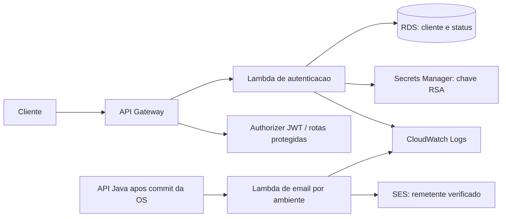

# fiap-lambda

Funções serverless de autenticação por CPF/e-mail e notificações de ordens de serviço. O cliente ativo recebe JWT RS256; o envio de e-mail usa uma Lambda por ambiente e Amazon SES.

📚 **[Documentação principal — fiap-docs](https://github.com/FIAP-GRUPO05/fiap-docs)**

## Tecnologias e requisitos

Python 3.12, boto3, PyJWT, PostgreSQL, AWS Lambda, API Gateway, SES e Terraform 1.13+. Docker com Compose v2 permite testar o runtime local. AWS CLI autenticado é necessário somente para o bootstrap administrativo; o CI usa OIDC.

## Arquitetura deste componente



Fonte editável: [`docs/arquitetura.mmd`](docs/arquitetura.mmd).

## Testar localmente

Na raiz deste repositório, em bash (Linux/macOS):

```bash
python3 -m venv .venv
.venv/bin/python -m pip install -r requirements-dev.txt
.venv/bin/python -m coverage run --source=codetoken,codeemail -m unittest discover -s tests -v
.venv/bin/python -m coverage report --fail-under=90
docker compose -p fiap-notifications-local -f compose.notifications.yaml up --build -d
.venv/bin/python .github/scripts/local_notification_smoke.py
```

No Windows (PowerShell), troque `.venv/bin/python` por `./.venv/Scripts/python.exe`.

O teste Docker chama o runtime Lambda em `http://127.0.0.1:19000` e confirma HTML, texto e correlação no [MailHog local](http://127.0.0.1:18025). Nenhum e-mail sai para a internet. Para encerrar: `docker compose -p fiap-notifications-local -f compose.notifications.yaml down`.

### Chaves locais x chaves na nuvem

`keys/generate-keys.py` e `keys/jwks.json` são utilitários de desenvolvimento local: o script gera `keys/private.pem` (ignorado pelo Git) e um `jwks.json` com `kid` padrão `fiap-key-1`. Nenhum dos dois é usado pelos ambientes na AWS. Em nuvem, a chave privada de cada ambiente fica no Secrets Manager em `fiap/<env>/jwt-signing` (lida pela Lambda via `JWT_PRIVATE_KEY_SECRET_ARN`) e o JWKS público é derivado dessa chave e servido pela própria Lambda em `GET /.well-known/jwks.json`, com `kid` `fiap-<env>-v1`.

A Lambda de e-mail aceita `{to, subject, body, html, correlationId}`. `operation=health` verifica o remetente SES sem enviar e-mail. SMTP fica restrito a `ENVIRONMENT=local`; a AWS usa SES e IAM, sem senha SMTP. Os testes de autenticação externos exigem ambiente provisionado e seus dados; sem eles, ficam explicitamente ignorados.

## Deploy e ambientes

O fluxo é `feature/* → develop → release/vX.Y.Z → prod → main`. Após o push da feature e o sucesso da CI, o PR é aberto automaticamente; os merges são manuais. Os próximos PRs são gerados após a promoção aprovada.

| Branch | Ambiente AWS | Deploy de código das Lambdas | `terraform apply` em `infra/managed` |
| --- | --- | --- | --- |
| `develop` | develop (`fiap-auth-develop`, `fiap-email-develop`) | Sim, no push após o merge | Não |
| `release/vX.Y.Z` | homol — homologação (`fiap-auth-homol`, `fiap-email-homol`) | Sim, no push após o merge | Não |
| `prod` | prod — produção (`fiap-auth-prod`, `fiap-email-prod`) | Sim, no push após o merge | Sim, antes do deploy de código |
| `main` | Nenhum | Não; `prod → main` apenas consolida a versão | Não |

O job `Deploy authentication` de `.github/workflows/pipeline.yml` escolhe o ambiente pelo nome da branch e, com a infraestrutura `active`, publica uma nova versão das duas Lambdas (`deploy_lambda.py` e `deploy_notifications.py`) e promove o alias `live`. Os passos de Terraform (`init -backend-config=backend.hcl`, `plan` e `apply`) só rodam quando a branch é `prod`, com o papel OIDC `fiap-gh-terraform-fiap-lambda`. Como o API Gateway, os segredos e as funções dos três ambientes estão no mesmo estado Terraform, merges em `develop` e `release/*` não alteram infraestrutura.

Em `destroyed`/`destroying`, deploys e promoções ficam bloqueados. Em `maintenance`, a CI permite validar e promover código, mantendo os deploys bloqueados. O bootstrap administrativo usa AWS CLI; a operação diária do CI usa OIDC e não exige credenciais AWS de cada integrante.

A CI inclui testes, cobertura mínima de 90%, runtime Docker com MailHog, segurança e validação Terraform. No deploy, o código é empacotado para Linux, publicado em versões e promovido ao alias `live` somente após os checks. A função de e-mail permanece no alias anterior quando o healthcheck SES falha.

Antes do primeiro provisionamento, configure `FIAP_NOTIFICATION_SENDER` com um endereço autorizado e verificado no SES de `sa-east-1`. No sandbox SES, use destinatários verificados ou o simulador da AWS. O bootstrap e a verificação do endereço são preparados pelo script administrativo do `fiap-k8s`.

## Provisionamento manual

Uso administrativo, fora da operação diária (que é feita pela CI). Pré-requisitos: AWS CLI autenticado na conta `456687462806` (`sa-east-1`), Terraform 1.13+ e os estados `fiap/platform-shared.tfstate` e `fiap/database-shared.tfstate` já aplicados, pois `infra/managed` lê a VPC, as sub-redes e o endereço do RDS por `terraform_remote_state`. Comandos em bash, na raiz do repositório:

```bash
# 1. Pacote da Lambda de autenticação: o archive_file do Terraform lê build/token-package
python3 -m pip install --platform manylinux_2_34_x86_64 --platform manylinux_2_28_x86_64 \
  --platform manylinux2014_x86_64 --implementation cp --python-version 3.12 \
  --only-binary=:all: --no-compile --target build/token-package -r requirements.txt
cp codetoken/main.py build/token-package/main.py

# 2. Remetente SES verificado (o mesmo valor da variável FIAP_NOTIFICATION_SENDER)
export TF_VAR_notification_sender="remetente@exemplo.com"

# 3. Terraform com o backend S3 de backend.hcl (estado fiap/lambda-shared.tfstate)
terraform -chdir=infra/managed init -backend-config=backend.hcl
terraform -chdir=infra/managed plan -out=lambda.tfplan
terraform -chdir=infra/managed apply lambda.tfplan
```

Se o ALB interno `fiap-shared-api` ainda não existir (primeiro provisionamento), acrescente `-var enable_backend_proxy=false` ao `plan`; o authorizer JWT e as rotas que encaminham para a API Java só são criados com o valor padrão `true`.

O `apply` cria os segredos `fiap/<env>/jwt-signing` vazios. Em seguida, inicialize as chaves RSA com `.github/scripts/bootstrap_signing_keys.py`, que percorre develop, homol e prod:

- **develop e homol:** gera uma chave RSA 2048 e grava no segredo apenas se ainda não houver versão `AWSCURRENT`; uma chave existente não é substituída.
- **prod:** sempre grava a chave lida da variável de ambiente `JWT_PRIVATE_KEY` (PEM RSA de pelo menos 2048 bits). No GitHub, ela vem do secret `JWT_PRIVATE_KEY` do repositório. Por isso, o secret do GitHub é a fonte da chave de produção: alterá-lo e repetir o bootstrap troca a chave usada em prod.

Pela CI, o bootstrap é o job `Bootstrap signing keys`, executado apenas em `workflow_dispatch`. O papel OIDC `fiap-gh-bootstrap-fiap-lambda` aceita as branches `develop`, `release/v*` e `prod`:

```bash
# Uma única vez, se o secret ainda não existir (não versione o .pem)
openssl genpkey -algorithm RSA -pkeyopt rsa_keygen_bits:2048 -out /tmp/jwt-prod.pem
gh secret set JWT_PRIVATE_KEY --repo FIAP-GRUPO05/fiap-lambda < /tmp/jwt-prod.pem
shred -u /tmp/jwt-prod.pem

gh workflow run pipeline.yml --repo FIAP-GRUPO05/fiap-lambda --ref develop
```

Alternativa local, com credenciais administrativas no AWS CLI (o script exige `JWT_PRIVATE_KEY` também fora da CI, porque sempre processa prod):

```bash
.venv/bin/python -m pip install -r requirements-dev.txt
JWT_PRIVATE_KEY="$(cat caminho/para/jwt-prod.pem)" .venv/bin/python .github/scripts/bootstrap_signing_keys.py
```

No caminho local, use o mesmo PEM gravado no secret `JWT_PRIVATE_KEY`; caso contrário, o próximo bootstrap pela CI substituirá a chave de prod pela do secret. O job da CI também executa `infra_guard.py`, que bloqueia a operação quando `FIAP_INFRA_STATE` ou o controle `fiap/operations/state.json` no S3 não estão `active`; a execução local do script não faz essa verificação.

## API e URLs dos ambientes

Cada ambiente (develop, homologação e produção) tem seu próprio API Gateway. As URLs não ficam fixadas aqui porque mudam sempre que a infraestrutura é recriada. A configuração atual, usada pela CI, fica na variável `FIAP_RUNTIME_CONFIG` (campo `api_url` de cada ambiente):

```bash
gh api repos/FIAP-GRUPO05/fiap-lambda/actions/variables/FIAP_RUNTIME_CONFIG --jq .value
```

Em cada `api_url`, o Swagger fica em `/swagger-ui/index.html`, o OpenAPI em `/v3/api-docs` e a saúde em `/actuator/health`. A autenticação CPF usa `POST /auth/customer`; operações protegidas exigem `Authorization: Bearer <JWT>`.

No orçamento, somente `GET /service-orders/{id}/budget/decision` é público e apresenta a identificação por CPF, sem dados da OS. Consulta JSON, visualização autenticada, aprovação e recusa passam pelo authorizer JWT; a aplicação valida a titularidade do cliente antes de ler ou alterar o orçamento.

## Contrato da Lambda de autenticação

A Lambda `fiap-auth-<env>` (`codetoken/main.py`) atende quatro rotas do API Gateway HTTP API do ambiente, sem authorizer. Todas as respostas usam `Content-Type: application/json`. O corpo é gerado com `json.dumps`, então caracteres acentuados chegam escapados (`\u00e1`, `\u00e3` etc.) e são decodificados normalmente por qualquer cliente JSON. Nos exemplos, `API` é a `api_url` do ambiente desejado, obtida em `FIAP_RUNTIME_CONFIG` (seção anterior).

### `POST /auth/customer` (cliente, por CPF)

O campo `cpf` aceita 11 dígitos ou o formato `000.000.000-00`; os dígitos verificadores são validados antes de consultar o banco.

```bash
API=<api_url do ambiente>   # ex.: https://<api-id>.execute-api.sa-east-1.amazonaws.com
curl -s -X POST "$API/auth/customer" -H 'Content-Type: application/json' -d '{"cpf":"529.982.247-25"}'
```

| Status | Quando | Corpo |
| --- | --- | --- |
| 200 | Cliente encontrado com `status = ACTIVE` | `{"accessToken": "eyJhbGciOiJSUzI1NiIs...", "expiresAt": 1793635200000, "tokenType": "Bearer"}` |
| 400 | Body que não é um objeto JSON | `{"message": "Body inv\u00e1lido"}` |
| 400 | CPF ausente, mal formatado, com dígitos repetidos ou verificadores errados | `{"message": "CPF inv\u00e1lido"}` |
| 401 | Nenhum cliente com esse CPF | `{"message": "Credenciais inv\u00e1lidas"}` |
| 403 | Cliente existe, mas o status não é `ACTIVE` | `{"message": "N\u00e3o foi poss\u00edvel autenticar o cliente"}` |

`expiresAt` é o instante de expiração em milissegundos desde a época Unix (o valor acima é ilustrativo).

### `POST /auth/login` (equipe, por e-mail e senha)

```bash
curl -s -X POST "$API/auth/login" -H 'Content-Type: application/json' \
  -d '{"email":"admin@exemplo.com","password":"<senha>"}'
```

| Status | Quando | Corpo |
| --- | --- | --- |
| 200 | Usuário da tabela `users` com senha bcrypt válida | Mesmo formato de `/auth/customer` (`accessToken`, `expiresAt`, `tokenType`) |
| 400 | Body que não é um objeto JSON | `{"message": "Body inv\u00e1lido"}` |
| 400 | `email` ou `password` ausentes, vazios ou não textuais | `{"message": "'email' e 'password' s\u00e3o obrigat\u00f3rios"}` |
| 400 | Senha com mais de 72 bytes (limite do bcrypt) | `{"message": "Password inv\u00e1lido"}` |
| 401 | E-mail inexistente ou senha incorreta | `{"message": "Invalid credentials"}` |

### `GET /.well-known/openid-configuration` e `GET /.well-known/jwks.json`

```bash
curl -s "$API/.well-known/openid-configuration"
# {"issuer": "https://<api-id>.execute-api.sa-east-1.amazonaws.com", "jwks_uri": "https://<api-id>.execute-api.sa-east-1.amazonaws.com/.well-known/jwks.json"}

curl -s "$API/.well-known/jwks.json"
# {"keys": [{"kty": "RSA", "key_ops": ["verify"], "n": "...", "e": "AQAB", "kid": "fiap-develop-v1", "use": "sig", "alg": "RS256"}]}
```

O `issuer` é o endpoint do próprio API Gateway do ambiente (variável `JWT_ISSUER`). O JWKS é calculado a partir da chave privada do Secrets Manager e responde com `Cache-Control: public, max-age=300`. É esse documento que o authorizer JWT do API Gateway usa para validar as assinaturas.

### Usando o token em uma rota protegida

As rotas que não estão na lista pública passam pela rota `ANY /{proxy+}`, protegida pelo authorizer JWT (issuer do ambiente e audiência `fiap-api`). Exemplo com o token de cliente consultando o orçamento de uma ordem de serviço da qual ele é titular:

```bash
TOKEN=$(curl -s -X POST "$API/auth/customer" -H 'Content-Type: application/json' \
  -d '{"cpf":"529.982.247-25"}' | python3 -c 'import json,sys; print(json.load(sys.stdin)["accessToken"])')

curl -s "$API/service-orders/<serviceOrderId>/budget" -H "Authorization: Bearer $TOKEN"
```

Sem o header, ou com token expirado, de outro ambiente ou com assinatura inválida, o próprio API Gateway responde `401` antes de chegar à aplicação. A verificação de papel e de titularidade da ordem de serviço é feita depois, pela API Java. `POST /auth/register` exige, além do JWT válido, o escopo `staff:manage`.

### Claims do JWT

O token é assinado em RS256, com header `kid` igual a `fiap-<env>-v1` (por exemplo, `fiap-prod-v1`).

| Claim | Valor |
| --- | --- |
| `iss` | Endpoint do API Gateway do ambiente (`JWT_ISSUER`) |
| `aud` | `fiap-api` |
| `sub` | Cliente: `id` do cliente. Equipe: e-mail do usuário |
| `customerId` | Cliente: `id` do cliente. Equipe: presente somente se o usuário tiver `customer_id` |
| `roles` | Lista com o papel sem o prefixo `ROLE_`: `["CUSTOMER"]` para clientes; o papel da tabela `users` para a equipe (por exemplo, `["ADMIN"]`) |
| `scope` | `staff:manage`, somente quando o papel é `ADMIN` |
| `iat` / `exp` | Emissão e expiração; `exp = iat + 3600` segundos (`JWT_EXP_SECONDS`) |

## Observabilidade

O que existe neste repositório, provisionado em `infra/managed`:

- **Logs das Lambdas:** `fiap-auth-<env>` e `fiap-email-<env>` usam o formato nativo de log JSON da AWS Lambda (`log_format = "JSON"`, nível `INFO`), nos grupos `/aws/lambda/fiap-auth-<env>` e `/aws/lambda/fiap-email-<env>`.
- **Access log do API Gateway:** cada estágio grava em `/aws/apigateway/fiap-<env>` um JSON com `requestId`, `routeKey`, `status`, `responseLength` e `integrationError`.
- **Retenção:** 14 dias em todos esses grupos. A CI confere isso com `.github/scripts/check_observability.py`.
- **Eventos da Lambda de e-mail:** cada envio registra `NotificationSent` (com `correlationId`, `environment`, `provider`, `messageId` e `requestId`) ou `NotificationFailed` (com `correlationId`, `environment`, `provider` e `errorCode`). O `correlationId` vem do payload enviado pela API Java, o que permite cruzar o log da Lambda com o da aplicação.

As Lambdas não têm agente nem integração com New Relic; os logs ficam no CloudWatch. O New Relic citado em `docs/CI-CD.md` monitora a API Java e o cluster Kubernetes, e o monitor de disponibilidade que consulta o JWKS é mantido no `fiap-k8s`.

## Membros da equipe

<table>
  <tr>
    <td align="center" width="160">
      <a href="https://www.linkedin.com/in/wesslima/" title="Wesley Lima">
        <br>
        <sub><b>Wesley Lima</b></sub>
      </a><br><sub>Backend Engineer</sub>
    </td>
    <td align="center" width="160">
      <a href="https://www.linkedin.com/in/tim-morgenstern-4581911b1/" title="Tim Morgenstern">
        <br>
        <sub><b>Tim Morgenstern</b></sub>
      </a><br><sub>Backend Engineer</sub>
    </td>
    <td align="center" width="160">
      <a href="https://www.linkedin.com/in/matheus-pitas-baptista/" title="Matheus Pitas Baptista">
        <br>
        <sub><b>Matheus Pitas Baptista</b></sub>
      </a><br><sub>Backend Engineer</sub>
    </td>
  </tr>
</table>
